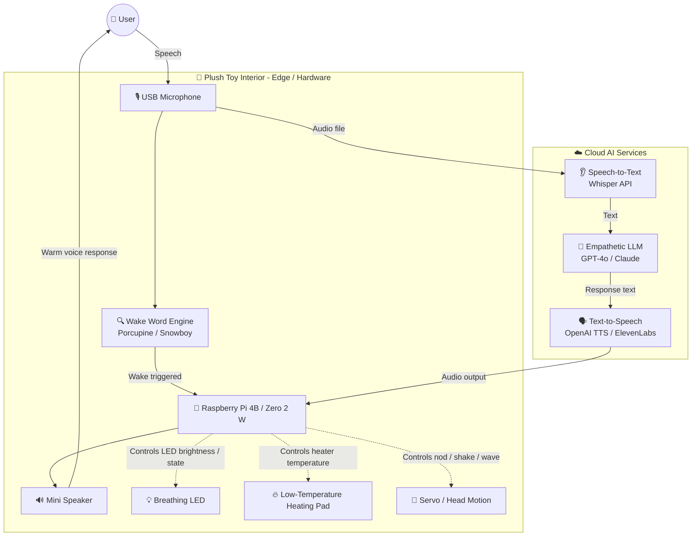

# 🎈 AI Baymax Plushie

AI Baymax Plushie is an open-source hardware and software modification project that transforms a commercial 50cm–80cm plush Baymax into an empathetic AI companion with voice interaction, local edge processing, and expressive physical responses.

<p align="center">
  
</p>

This project combines a Raspberry Pi, large language models (LLMs), voice recognition, and embedded hardware to create a comforting, human-like companion that can listen, respond, and react with warmth.

---

## ✨ Project Overview

The goal of this project is to turn a soft plush Baymax toy into a real AI-powered companion robot capable of:

- voice wake-up and continuous listening
- speech-to-text conversion
- empathetic conversational responses
- natural text-to-speech output
- optional warm touch feedback with a low-temperature heater
- breathing LED status indicators
- gentle motion such as nodding, shaking, and waving

By using a hybrid edge + cloud architecture, the plush can respond quickly at the device level while leveraging cloud AI for more natural and intelligent conversations.

---

## 🧠 Core Features

- 🎙️ Wake word detection
  - Runs locally on edge hardware
  - Enables low-latency wake-up and privacy-friendly processing
- 🧠 Empathetic LLM persona
  - Custom system prompts allow Baymax to respond gently, patiently, and supportively
- 🗣️ Natural voice interaction
  - Integrates STT and TTS for conversational voice experiences
- 🔥 Physical warmth
  - Uses a low-temperature heating pad to simulate the feeling of a warm embrace
- 💡 Breathing state LED
  - Indicates idle, listening, thinking, or speaking states
- 🤝 Gentle motion feedback
  - Can nod, shake, or wave in a safe, bounded way

---

## 🏗️ System Architecture

The project uses a hybrid architecture where edge devices handle immediate sensing and local control, while cloud AI handles complex reasoning and speech generation.



This architecture keeps the toy responsive, safe, and private on the edge, while offloading higher-level language understanding to cloud models.

---

## 🧰 Hardware Requirements

1. Plush shell
   - 50cm–80cm commercial Baymax-style plush
2. Main controller
   - Raspberry Pi 4B (recommended)
   - Raspberry Pi Zero 2 W (compact version)
3. Audio
   - USB microphone
   - mini speaker with amplifier
4. Power
   - 10,000mAh power bank with pass-through charging support
5. Accessories
   - 3D-printed protective enclosure
   - zip ties, velcro, heat sinks, thermal insulation
6. Optional modules
   - low-temperature heating pad
   - status LEDs
   - servo motors for head gestures

---

## 🛠️ Software Stack

- Operating System: Raspberry Pi OS / Linux
- Language: Python 3
- Wake word detection: Porcupine, Snowboy, or similar
- STT: OpenAI Whisper API / local alternatives
- LLM: GPT-4o, Claude, or open-source local LLMs
- TTS: OpenAI TTS, ElevenLabs, or offline TTS stack
- Control layer: Python service or local agent logic

---

## 🚀 Quick Start

### 1. Clone the project

```bash
git clone https://github.com/yourusername/AI-Baymax-Plushie.git
cd AI-Baymax-Plushie
```

### 2. Set up a virtual environment

```bash
python3 -m venv venv
source venv/bin/activate
```

### 3. Install dependencies

```bash
pip install -r requirements.txt
```

### 4. Configure environment variables

Create a `.env` file from `.env.example` and fill in your credentials:

```env
OPENAI_API_KEY=your_openai_api_key
PICOVOICE_API_KEY=your_picovoice_api_key
```

### 5. Run the desktop prototype

Before integrating into the plush body, test the system on a desktop setup:

```bash
python main.py
```

---

## ⚠️ Safety Warning

This project involves installing electronics into a soft plush body, which introduces fire and thermal risks. Safety must be treated as a primary design requirement.

Important precautions:

- Keep the Raspberry Pi and battery isolated from plush fabric
- Use flame-resistant or heat-safe enclosure materials
- Add ventilation and thermal protection
- Do not allow bare boards to touch cotton or fabric directly
- Monitor heat generation during testing
- Use a regulated power supply and ensure correct voltage compatibility
- Treat this as a prototype until it has passed appropriate toy safety testing

---

## 📦 Repository Structure

```text
AI-plush-giraffe/
├── README.md
├── ai_readme.md
├── PROPOSAL.md
├── SKILL.md
├── GiraffeAgent.ino
├── assets/
│   ├── plush_toy_giraffe.webp
│   ├── AI-plush-giraffe_architecture_diagram.png
│   └── AI-plush-toy_block_diagram.png
└── scripts/
    └── index.html
```

---

## 📜 License

This project is released for educational and experimental purposes. Please review local safety, electronics, and product regulations before modifying plush toys or other consumer products.

---

## 🤝 Contributing

Contributions are welcome. If you are interested in improving the project, feel free to open an issue or submit a pull request.

---

## 🔮 Future Direction

Planned enhancements include:

- local wake-word detection with lower latency
- improved open-source voice pipeline
- better motion control and servo safety limits
- smarter emotional prompt tuning
- stronger integration with edge AI and local models
- more realistic on-device companion behavior

---

## Acknowledgements

This project draws inspiration from the concept of an AI plush companion and the growing intersection of edge computing, voice AI, and embodied interaction.
